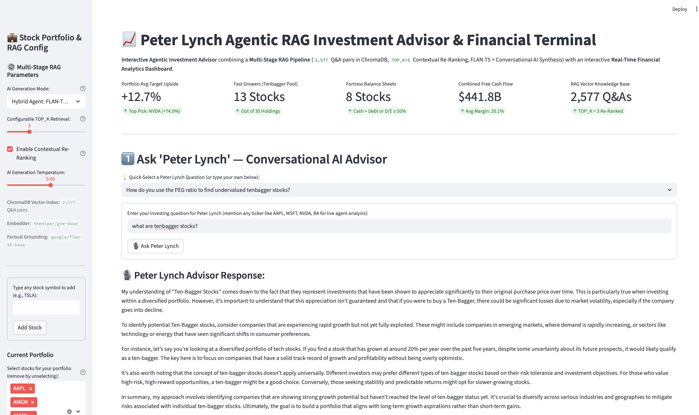
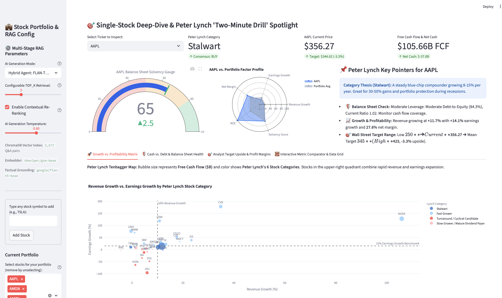

# 📈 Peter Lynch Agentic RAG Investment Advisor

An interactive agentic investment advisor featuring **real-time financial reporting** and an **end-to-end multi-stage RAG pipeline** (data ingestion to dynamic response generation) using **Python, Streamlit, ChromaDB, Sentence Transformers (`thenlper/gte-base`), and Google FLAN-T5 (`google/flan-t5-base`)**, emulating Peter Lynch's investment methodology.
---






---

## ✨ Key Features & Architecture

1. **End-to-End Multi-Stage RAG Pipeline**:
   - **Stage 1 — Data Ingestion & Unicode Normalization (`utils/convert_to_unicode.py`, `data_loader.py`)**: Merges and normalizes **2,577+ financial Q&A pairs** covering *One Up On Wall Street*, *Beating the Street*, Fidelity Magellan Fund insights, and financial ratio analysis into `data/peter_lynch_qna_unicode.csv`.
   - **Stage 2 — Query Preprocessing (`rag.py`)**: Normalizes conversational queries (`you`, `your`, `Peter Lynch`) and extracts financial domain entities and stock tickers.
   - **Stage 3 — ChromaDB Vector Similarity Retrieval (`embedding_store.py`)**: Encodes Q&A pairs using `thenlper/gte-base` SentenceTransformers into a persistent ChromaDB vector index (`chroma_persist`) with cosine similarity search.
   - **Stage 4 — Contextual Re-Ranking (`rag.py`)**: Re-ranks candidate Q&A pairs by combining semantic vector similarity, lexical keyword overlap, and financial domain boosting with configurable `TOP_K=3` parameters.
   - **Stage 5 — Conversational AI Agent & FLAN-T5 Synthesis (`llm_model.py`, `rag.py`)**: Generates conversational responses in Peter Lynch's voice using `google/flan-t5-base` and evaluates live portfolio stocks across Peter Lynch's **6 Stock Categories** (*Slow Growers, Stalwarts, Fast Growers, Cyclicals, Turnarounds, Asset Plays*).

2. **Real-Time Financial Reporting & Portfolio Dashboard (`app.py`)**:
   - Tracks Dow Jones 30 constituents and custom tickers with live fundamental ratios (`debtToEquity`, `currentRatio`, `returnOnEquity`, `profitMargins`, `revenueGrowth`, `earningsGrowth`, `freeCashflow`).
   - Features an **Agentic Stock Evaluator** that scores balance sheet solvency and runs Peter Lynch's Two-Minute Drill on any ticker.

3. **Value–Quality K-Means Clustering**:
   - Normalizes fundamental ratios with `MinMaxScaler` and clusters portfolio holdings via `KMeans` to surface Long and Watch/Short candidates.

---

## 🚀 Quick Start

```bash
# 1. Create and activate virtual environment
python3 -m venv .venv
source .venv/bin/activate

# 2. Install dependencies
pip install -r requirements.txt

# 3. Build Unicode-normalized 2,500+ Q&A dataset (also runs automatically on startup)
python3 utils/convert_to_unicode.py

# 4. Launch Streamlit application
streamlit run app.py
```
